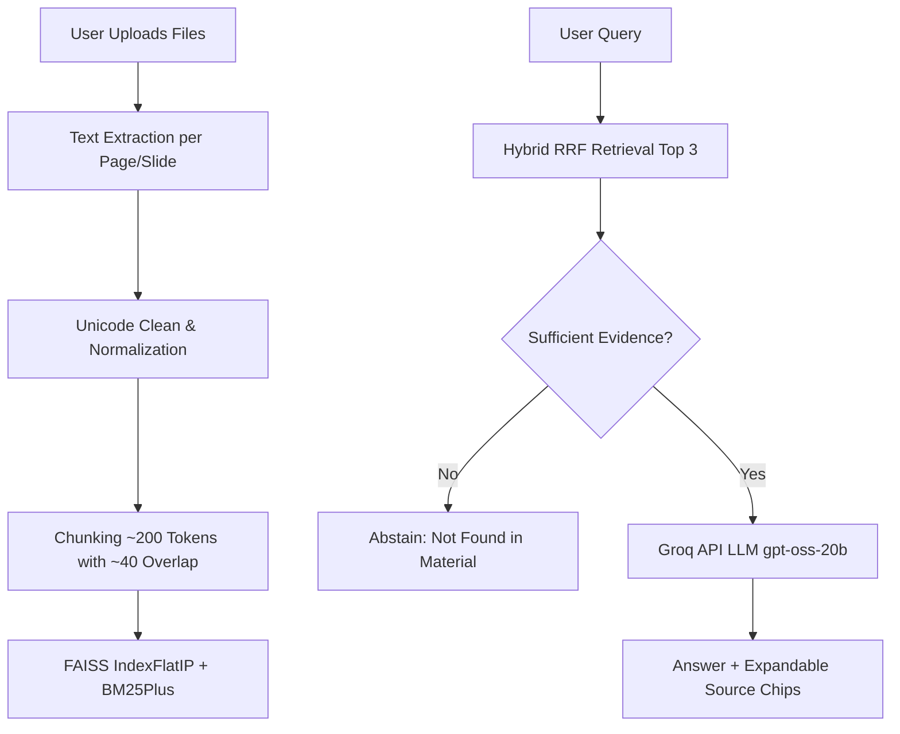

# ExamSense 🎓

AI-powered study assistant that provides grounded, concise answers with direct source citations from your study materials.

## Features
- **Library**: Upload text-based course documents (PDF, PPTX, DOCX, EPUB, TXT, MD). All processing and indexing are in-memory per session.
- **Ask**: Fast hybrid search (Dense + BM25) with Reciprocal Rank Fusion, grounded Groq answers (<= 120 words), and expandable source chips.
- **Teacher Mode**: Retrieval evaluation harness measuring Precision@3 and Recall@3 across Dense, BM25, and Hybrid methods with zero LLM calls.

## Supported Files
- **PDF**: Page-by-page text extraction via PyMuPDF.
- **PPTX**: Slide titles, body text, tables, recursive shape grouping, and speaker notes via python-pptx.
- **DOCX**: Structured headings, paragraphs, and tables via python-docx.
- **EPUB**: Chapter-by-chapter extraction with title preservation via ebooklib + BeautifulSoup.
- **TXT / MD**: Plain text files with unicode normalization.

> **Note**: Scanned or image-only documents without selectable text are automatically detected and rejected.

## Architecture



## Running Locally

1. **Clone & create virtual environment (Python 3.12 recommended)**:
   ```bash
   python -m venv .venv
   # Windows:
   .venv\Scripts\activate
   # Linux/macOS:
   source .venv/bin/activate
   ```

2. **Install dependencies**:
   ```bash
   pip install -r requirements.txt
   ```

3. **Configure API key (optional for local testing)**:
   Copy `.env.example` to `.env` or `.streamlit/secrets.toml.example` to `.streamlit/secrets.toml`:
   ```toml
   GROQ_API_KEY = "gsk_your_groq_api_key_here"
   ```
   *(Or type your free Groq key directly in the sidebar inside the app).*

4. **Launch app**:
   ```bash
   streamlit run app.py
   ```

## Deploying to Streamlit Community Cloud

1. **Push your code to GitHub**:
   Create a GitHub repository and push your project files (verify `.env` and `secrets.toml` are not committed).

2. **Deploy on Streamlit Community Cloud**:
   - Go to [share.streamlit.io](https://share.streamlit.io/) and click **New app**.
   - Select your repository and branch, set Main file path to `app.py`.
   - Click **Advanced settings**:
     - Choose **Python 3.12**.
     - In **Secrets**, add your Groq API key:
       ```toml
       GROQ_API_KEY = "gsk_your_groq_api_key_here"
       ```
   - Click **Deploy**.

## Known Limitations
- **Text-based files only**: Scanned PDFs and image-based presentations without selectable text are rejected.
- **Figures, equations, and images**: Visual diagrams, handwritten equations, and raster images are not parsed.
- **Free API rate limits**: Free Groq tier rate limits apply (per-session cap of 30 questions on shared key; users can supply their own free key to bypass).
- **Session privacy**: Files, embeddings, and FAISS indices are held in memory only for the duration of the browser session and are never persisted to disk.
- **Lightweight embedding model**: Uses `BAAI/bge-small-en-v1.5` (~230 MB RAM footprint) optimized for the free cloud tier.
